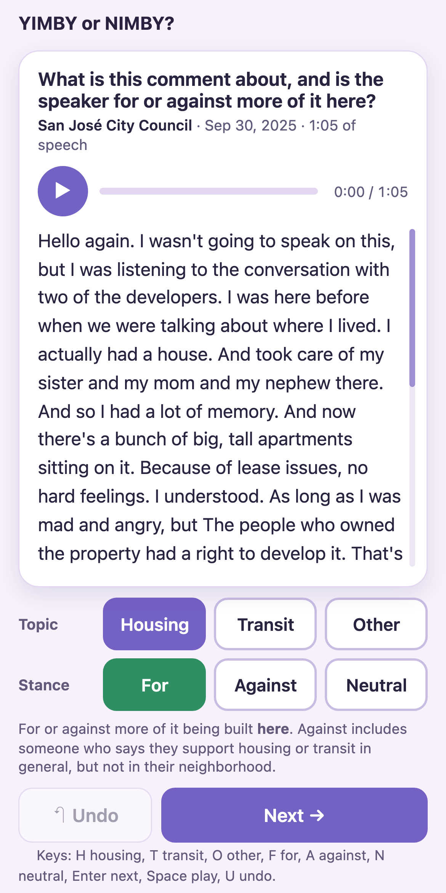
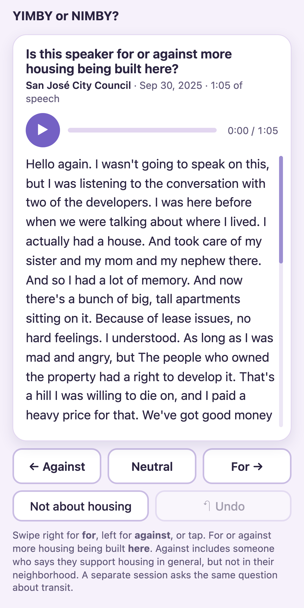
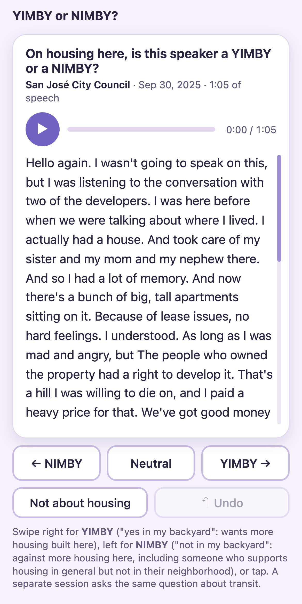
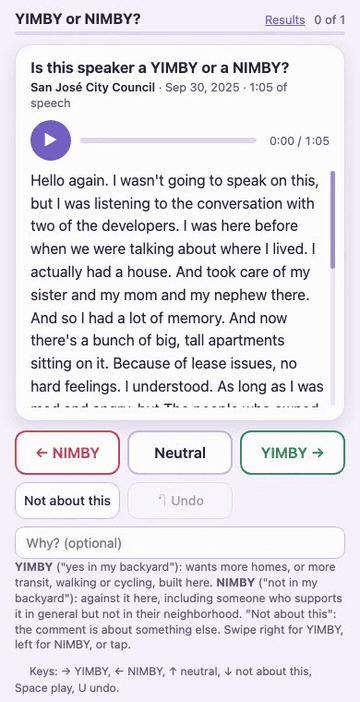

**TLDR:**

- I built a phone page for labelling public comments from Bay Area meetings. Friends read and hear each comment and say whether the speaker is a YIMBY or a NIMBY.
- The answers are a human check on the automated labels in the [Exploratory Dashboard of Bay Area Public Meetings](/visualizations/bay-area-transit-analysis/).
- I tried three designs and chose Option C: one YIMBY or NIMBY question, answered with a swipe.

YIMBY means "yes in my backyard": the speaker wants more homes, or more transit, walking or cycling, built in their area. NIMBY means "not in my backyard": the speaker is against it in their area.

**Option A: two questions.** The labeller picks the topic, then picks for, against or neutral. This records the topic and the stance separately.

**Option B: one question, for or against.** The labeller swipes right for "for" and left for "against". It takes one action per comment instead of three.

**Option C: one question, YIMBY or NIMBY. This is the one I chose.** The swipe is the same as in Option B, but the answers are YIMBY and NIMBY. These are the words the study uses, so the answers need no translation before they are compared with the automated labels.

**The final version.** It is Option C with one change: it asks one general question for housing and transit together, instead of one session for each. The words light up as the audio plays, and a swipe saves the answer and shows the next comment.

